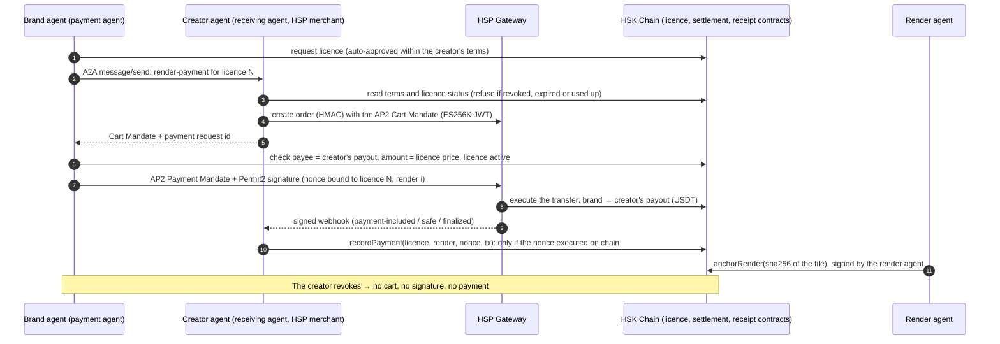

# Likeness on HSK Chain

[](https://github.com/rohitshukla11/likeness-hsk/actions/workflows/ci.yml)

**Agent-to-agent licensing and per-render payments for AI ads that use a real person's face, paid
through HSP on HSK Chain, with consent enforced before any money moves.**

A brand's **payment agent** asks a creator's **receiving agent** for a licence over A2A. For each
render, the creator's agent sends the payment conditions as an AP2 **Cart Mandate**: the creator's own
terms, read from HSK Chain. The brand's agent checks them against the brand's policy and the chain,
signs an AP2 **Payment Mandate** with the brand wallet, and the **HSP Gateway** verifies it and executes
the stablecoin payment on HSK Chain. A render is recorded only after its payment executed on chain.
Every delivered file gets a receipt anyone can verify, and a revoked licence stops the next payment
before anything is signed.

Built for the **HSK Chain Horizon Hackathon**, track **Agent Payments & A2A Settlement (HSP)**.
What is reused and what is new: [docs/HACKATHON.md](docs/HACKATHON.md).

## Try it: https://35-254-5-116.sslip.io

The full app, running on HSK Chain testnet (chain 133) with HSP Agentic Payment through our offline MCP
emulator until HashKey's QA server allowlists this server's address (35.254.5.116); the banner says which.

The walk-through: **Creators → Ana Reyes → Request licence → Brand → Pay for next render → approval 1
(before signing) → approval 2 (before submitting) → HSP status, recorded, receipt → Download → Verify →
Creator dashboard → Revoke → Pay again (refused before anything is signed) → Verify (Revoked)**.
"Behind the scenes" on the Brand page shows every A2A message, mandate and HSP call. The original console
is at [/console](https://35-254-5-116.sslip.io/console).

- **Open to everyone:** the landing page, the creator's terms and licences, payments with explorer links,
  **Verify** (drop a file: Licensed, Expired, Revoked or Unknown), How it works and the creator agent's A2A card.
- **Operator actions** (request a licence, pay for a render with the two approvals, revoke): unlock them
  with the **demo password** at the top right. It is not in this repository; judges get it from the team with
  the submission (ask us if you don't have it).
- **Limits:** at most 10 paid renders a day (UTC), 0.05 test USDT each, one payment at a time, per-address
  rate limits. Everything is testnet: the tokens have no value.
- The server has its own testnet-only wallets (creator `0xD2925E4A…29ca9`, brand `0x8E9B246D…4DDec`);
  its keystores are encrypted and their password lives in Google Secret Manager.

The web UI (`web/`, Next.js) was rebuilt during the hackathon from the design of Rohit's earlier
Likeness project; what is reused and what is new: [docs/HACKATHON.md](docs/HACKATHON.md).

## Live on HSK Chain testnet (chain 133)

| Contract | Address (verified on Blockscout) |
|---|---|
| CreatorRegistry | [`0x388cd6c6ee71aed1d052894b6981fdb9c7aad6be`](https://testnet-explorer.hskchain.net/address/0x388cd6c6ee71aed1d052894b6981fdb9c7aad6be) |
| LicenseRegistry | [`0x91e2df3ec2188812eb026ce101af4e772a43aff4`](https://testnet-explorer.hskchain.net/address/0x91e2df3ec2188812eb026ce101af4e772a43aff4) |
| ReceiptAnchor | [`0x9da3a94fc7924be25e573bafaf5ef33d2749e4c1`](https://testnet-explorer.hskchain.net/address/0x9da3a94fc7924be25e573bafaf5ef33d2749e4c1) |
| HspSettlement | [`0x4a2bafa2279ea1b0ca67fb8d149eebbc890bf869`](https://testnet-explorer.hskchain.net/address/0x4a2bafa2279ea1b0ca67fb8d149eebbc890bf869) |
| TestUSDT (testnet only, no value) | [`0xc0336d73fde52b1c8463b7f746da33e71102fcea`](https://testnet-explorer.hskchain.net/address/0xc0336d73fde52b1c8463b7f746da33e71102fcea) |
| Owner of all four: a Safe{Wallet} | [`0x760Dff71d6345b7dd0dA674b034495f1A783c0c7`](https://testnet-explorer.hskchain.net/address/0x760Dff71d6345b7dd0dA674b034495f1A783c0c7) |

**One full run on testnet** (`pnpm run testnet`), licence 4:
1. [Licence issued](https://testnet-explorer.hskchain.net/tx/0xf1961d151bad8e7ea4e5295e3208b241319d895ca695d965d0ff99cb0635af03)
   within the creator's published terms.
2. [Payment](https://testnet-explorer.hskchain.net/tx/0xf193608b8a8b39092eebab0d4eef8f9fb88152915d80962e5a3901f5c794ae5f)
   of 0.05 tUSDT: a Permit2 transfer from the brand straight to the creator's payout.
3. [Recorded](https://testnet-explorer.hskchain.net/tx/0xfa078a33329f78367597a08257eab3cea27295cb3cbb68284bfbc8391191eaa8)
   by the creator's agent, with the nonce bound to this render.
4. [Receipt](https://testnet-explorer.hskchain.net/tx/0x784bf8a9e4b7bfddff59c7ac982fa8ca3664acb6a0d70925d99480ca0c4d4e0d)
   anchored for the delivered file.
5. [Revoked](https://testnet-explorer.hskchain.net/tx/0xaa9e88ffdec92bf549bc52ea6ea79dc8cc0706b77b2facb55925afede71e44d8)
   by the creator; the next payment is refused before the brand signs anything.

**HSP Gateway: emulated until HashKey issues merchant credentials** (requested). The emulator follows
HashKey's published Merchant API, and the app says so on every page. The real-Gateway path is built and
switches on with one config file ([docs/HSP_SETUP.md](docs/HSP_SETUP.md)).

## Real HSP Agentic Payment on QA

HashKey's **HSP Agentic Payment** MCP server (QA, guide revision 2026-10-30) is wired into both agents
through the official MCP client SDK: the creator's agent creates the order (`merchant_name` "Likeness",
`pay_to` the creator's on-chain payout, network and token from `get_chain_config`); the brand's agent
prepares, signs exactly the `eip712` HSP returns, finalizes and submits, with **two approvals in the
brand console** (recipient, payer, `token_total_raw`) before signing and before submitting; the
creator's agent follows `query_payment` every 15 s and reports the team attribution.

**Status:** built and tested offline against an MCP emulator with the same eight tools. The first QA
payment waits for HashKey to allowlist our egress IP (the one health check so far answered 403). Flow,
rules and the redeploy plan: [docs/HSP_AGENTIC.md](docs/HSP_AGENTIC.md); the step-by-step live run:
[docs/HSP_LIVE_RUN.md](docs/HSP_LIVE_RUN.md).

**Mainnet-ready: one-command runbook, executed if selected.** The HSK Chain organisers announced in
the hackathon's Telegram group that projects don't need a mainnet deployment during the hackathon:
testnet is the submission, and winners deploy to mainnet afterwards. Our
[runbook](docs/MAINNET_RUNBOOK.md) for HSK mainnet (chain 177) is written and was rehearsed end to end
on a local fork of mainnet with real USDT, Permit2 and HSKSwap state.

## The problem

AI can put anyone's face into an ad in seconds. Creators have no way to say yes on their own terms (a
price per render, allowed uses, an expiry, a cap), get paid per use, or take it back. Brands have no
safe way to buy that consent at machine speed. Agents can negotiate and pay, but only if payment,
consent and proof are tied together, so that money never moves for a render the creator didn't agree
to, and every licensed file can be checked later.

## How it fits the track

> "the Payment Agent constructs a Payment Mandate based on the payment conditions transmitted by the
> receiving Agent, completes the wallet signature, and then verifies and executes the on-chain payment
> through the existing Gateway of HSP."

| Track spec | Here |
|---|---|
| Receiving Agent | **Creator agent** (`agents/src/creator-agent`). It serves an A2A agent card (`/.well-known/agent-card.json`, AP2 merchant role) and JSON-RPC `message/send`. |
| Payment conditions transmitted | The creator agent reads the creator's terms and the licence status on HSK Chain, creates the HSP order, and returns an **AP2 Cart Mandate**: x402 method data (chain, USDT, the creator's payout) and an ES256K `merchant_authorization` over the RFC 8785 cart hash. A revoked, expired or used-up licence gets no cart. |
| Payment Agent constructs the Payment Mandate | **Brand agent** (`agents/src/brand-agent`). It checks the merchant's signature, that `pay_to` is the creator's payout on chain, that the amount is the licence price, and its policy (price cap, allowed uses, daily budget). Then it builds the **AP2 Payment Mandate**. |
| Completes the wallet signature | The brand wallet signs a **Permit2** transfer for USDT (or **EIP-3009** for USDC.e), with a nonce bound to this licence and render, plus a signature tying the mandate to the cart. |
| Verifies and executes through the HSP Gateway | **HSP client** (`agents/src/hsp`). It handles HMAC-signed merchant calls, submits the Payment Mandate, verifies the Gateway's signed webhooks, and polls status. |
| On-chain settlement | **HspSettlement** records the payment only if the brand's authorization **executed on chain**, then the render agent anchors the receipt. |

## Architecture



**Contracts** (`contracts/`, Solidity 0.8.30, Foundry):
- **CreatorRegistry:** attested creators and their terms (price per render, allowed uses and regions,
  maximum duration, render cap, auto-approve).
- **LicenseRegistry:** soulbound, expiring licences that the creator can revoke.
- **ReceiptAnchor:** one receipt per delivered file hash.
- **HspSettlement:** the HSP payment binding. It is the only writer of renders and receipts.

## What the chain proves, and what an agent attests

- **Proven on chain:**
  - the licence was active when the payment was recorded;
  - this is the licence's next render, within its cap;
  - the **licensee's own stablecoin authorization executed** (read from the token's nonce registry:
    Permit2's nonce bitmap, or USDC.e's `authorizationState`);
  - with the bound nonce `keccak256(settlement, chainId, licenceId, renderIndex)`, it was **for exactly
    this render**;
  - no authorization pays for two renders;
  - a receipt exists only for a paid render.
- **Attested by the creator's agent:** the amount and the recipient of that authorization, which the
  token's nonce registry doesn't show.
  - The creator agent checks the transfer in the transaction before recording it, and stores the HSP
    transaction hash for anyone to audit.
  - Only the creator's own agent can record for that creator, so a brand can't underpay.
- **If the HSP Gateway picks the nonce:** the creator agent records the nonce that executed. The
  payment is stored with `nonceBound = false`, so everyone can see the binding was attested rather than
  proven.

## Security notes

- **Nothing is held.** The settlement contract never holds funds; HSP pays the creator directly.
  There's no escrow to drain and nothing to refund.
- **Consent before money:** both agents check the licence on chain before a cart is made or a
  signature is given.
- **Bounded approvals:** the brand approves Permit2 for a bounded amount (1.5 USDT), not unlimited.
- **Downloads need the licensee's wallet.** The licensee signs a dated claim, checked against the
  licence on chain, so knowing a file's hash isn't enough. This fixes a hole found in the audit of the
  earlier version.
- **Keys:**
  - all wallets are new, in encrypted keystores whose password is in the macOS Keychain;
  - the HSP merchant key and credentials are owner-only files (mode 600), gitignored, never logged;
  - the message log holds public data only, and redacts fields named like secrets (keys,
    passwords, credentials) if one ever slips in.
- **Ownership:** contract ownership sits with a Safe. Owner powers are limited to setting the
  attester and render agents, suspending a creator, and one-time wiring; the owner can't move
  anyone's money.
- **Mainnet guards:** every script that can spend on mainnet refuses without an explicit environment
  flag, and the HSP emulator never runs against mainnet.

## Known limitations

- **HSP Agentic Payment on QA not run yet:** waiting for HashKey's IP allowlisting. Until the contracts
  are redeployed with the token HSP pays in, a QA payment is shown but not recorded on chain.
- **HSP merchant API is emulated** until HashKey issues merchant credentials. Three details are unconfirmed and
  isolated in one place each:
  - the payer-side submit route;
  - where the Permit2 signature goes in the mandate, and the `user_authorization` format;
  - the JWT audience spelling.
- **TestUSDT on testnet:** HSP's testnet USDT has no public faucet, and the official
  [faucet](https://hskchain.net/faucet) gives testnet HSK only, so payments on testnet use our own
  TestUSDT, which has no value. On mainnet, HSP's own USDT is used.
- **Amount and recipient** are attested by the creator's agent, not proven on chain (see above).
- **Renders:** a marked TEST RENDER by default. Gemini renders only when an API key is set.
- **No C2PA in this build:** the earlier Likeness projects signed a C2PA content credential into each
  render; this build drops it (a native module, and little value on SVG test renders). Verify relies on the
  on-chain receipt keyed by the file's sha256, anchored only after the HSP payment was recorded.
- **One demo creator:** Ana Reyes is the demo creator on this deployment, attested by our own attester, not a
  KYC provider. Her portrait and the landing photos are the ones from the earlier Likeness app (likeness-arc).
- **Single instance:** one process holds the agents' state. A production deployment would use a
  persistent store.

## Run it

```sh
git clone --recurse-submodules https://github.com/rohitshukla11/likeness-hsk && cd likeness-hsk
(cd contracts && forge build && forge test)            # 79 contract tests; fork suites run with HSK_RPC_URL / HSK_TESTNET_RPC_URL
cd agents && pnpm install && pnpm test                 # 64 agent tests (anvil from Foundry needed)
LIKENESS_MODE=local pnpm app                           # http://127.0.0.1:8788: a local chain, no keys needed
LIKENESS_HSP=agentic LIKENESS_MODE=local pnpm app      # the same with HSP Agentic Payment (MCP emulator) and the approvals
pnpm run vm keys && pnpm run vm setup                  # the public server's own testnet wallets (dry run; --broadcast sends)
cd ../web && pnpm install && pnpm dev                  # the web UI on http://localhost:3000, over the agents app on 8788
```

**Pages (web UI):**
- **Creators** and **Ana Reyes**: her on-chain terms and the licence request.
- **Brand:** pay for a render with the two approvals, HSP's status, each step with explorer links, the
  download, and "Behind the scenes" (every A2A message, mandate and HSP call).
- **Creator dashboard:** licences, payments received, revoke.
- **Verify:** Licensed / Expired / Revoked / Unknown for any file. **How it works:** the flow and the contracts.
- The original console (`agents/public`) is served at `/console` by the agents app.

**Testnet run:** `pnpm run testnet` (needs the project's keystores).

## Repository

| Path | What |
|---|---|
| `contracts/` | The four contracts, 79 tests (unit, fuzz, both payment rails, a classic-Tether USDT), and HSK mainnet and testnet fork suites |
| `agents/src/creator-agent`, `brand-agent`, `render` | The agents |
| `agents/src/hsp` | The HSP client (HMAC, ES256K cart JWT, AP2 mandates, Permit2 and EIP-3009 signatures, webhooks) and the Gateway emulator |
| `agents/src/a2a` | A2A agent card, JSON-RPC `message/send`, tasks |
| `agents/src/app`, `agents/public` | The demo app |
| `agents/scripts` | `deploy`, `fund`, `safe`, `verify`, `run` (testnet or mainnet), `recover`, `hsp:check` |
| `deployments/` | Public addresses and transaction hashes |
| `docs/` | [HACKATHON](docs/HACKATHON.md) (reused vs new), [HSP_SETUP](docs/HSP_SETUP.md), [MAINNET_RUNBOOK](docs/MAINNET_RUNBOOK.md) |

MIT licence.
