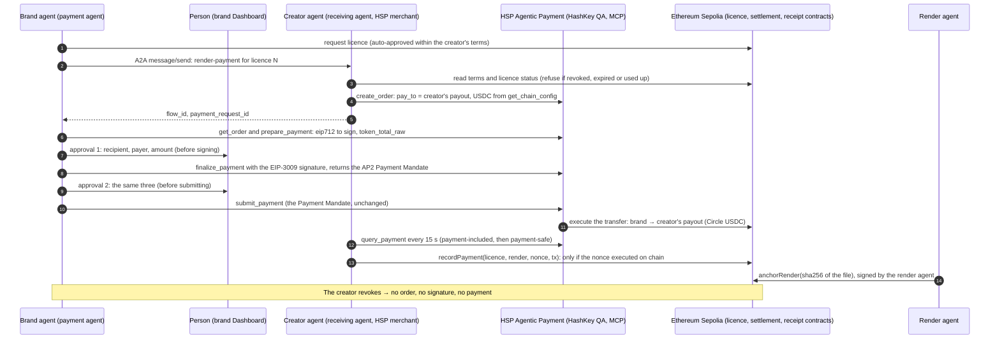

# Likeness on HSK Chain

> **Hackathon project (HSK Chain Horizon, Nov 2026). Demo server shut down; see the
> [demo video](https://youtu.be/fhu-Uw2wYeE) and the [on-chain transactions](#live-on-ethereum-sepolia-through-hashkey-qa).**

[](https://github.com/rohitshukla11/likeness-hsk/actions/workflows/ci.yml)

**Agent-to-agent licensing and per-render payments for AI ads that use a real person's face, paid
through HSP on HSK Chain, with consent enforced before any money moves.**

A brand's **payment agent** asks a creator's **receiving agent** for a licence over A2A. For each
render, the creator's agent sends the payment conditions as an AP2 **Cart Mandate**: the creator's own
terms, read from HSK Chain. The brand's agent checks them against the brand's policy and the chain,
signs an AP2 **Payment Mandate** with the brand wallet, and the **HSP Gateway** verifies it and executes
the stablecoin payment on HSK Chain. A render is recorded only after its payment executed on chain.
Every delivered file gets a receipt anyone can verify, and a revoked licence stops the next payment
before anything is signed.

Built for the **HSK Chain Horizon Hackathon**, track **Agent Payments & A2A Settlement (HSP)**.
What is reused and what is new: [docs/HACKATHON.md](docs/HACKATHON.md).

**Demo video:** https://youtu.be/fhu-Uw2wYeE

## The demo server (offline)

The public demo server (hsk.likeness.site) was shut down on 5 Nov 2026, after the hackathon, and its accounts,
photos and renders were deleted; the links to it in this repo no longer work. This section records what it did.

The full app ran **live through HashKey's HSP Agentic Payment QA server on Ethereum Sepolia (testnet)**, paying in
Circle's test USDC, as the organisers allowed during the hackathon; see
[Live on Ethereum Sepolia through HashKey QA](#live-on-ethereum-sepolia-through-hashkey-qa). The contracts on both
testnets remain on chain.

**Sign in with Google** at the top right (email and profile only), then choose once per Google account:

- **Brand:** Creators → a creator → request a **licence bundle** (one brief, a number of images and
  videos) → Dashboard → **Make image** or **Make video** → edit the prompt (pre-filled with the exact text
  the model receives) → approval 1 (before signing) → approval 2 (before submitting) → HSP status, recorded
  on chain, AI generation, receipt → preview and Download → **Verify**. Each bundle keeps a gallery of its
  renders; "Behind the scenes" shows every A2A message, mandate and HSP call.
- **Creator:** Connect YouTube (read-only, once; Google may show its "unverified app" screen for that
  permission: Advanced → Go to Likeness) → your photo, with an explicit consent box → your terms →
  **Register on HSK Chain**. Your dashboard lists every bundle of your likeness with **Revoke** (both of its
  licences), the payments you received, and **Ads made with your likeness** across all brands.
- **Open to everyone:** the landing page, creators and their terms, **Verify** (drop a file: Licensed,
  Expired, Revoked or Unknown, with the bundle and the exact prompt), How it works and the A2A agent cards.
- **Creators** on the public site are people who signed in with Google, verified their YouTube channel and
  consented to their photo; the synthetic demo creator Ana Reyes (an illustration) is not shown there.
- **Limits:** AI ads per UTC day: 3 images and 1 video per brand account, 10 images and 2 videos across the
  server; at most 0.05 test USDC per image and 0.15 per video (8 s); one payment at a time; per-address rate
  limits. For a live demo the admin can raise these for one UTC day (`/admin` → Demo prep: 10 images and 4 videos
  per brand, 20 and 6 across the server); they lapse at 00:00 UTC. Everything is testnet: the tokens have no value.
- **Wallets:** payments come from the server's shared demo brand agent wallet (`0x8E9B246D…4DDec`) on behalf of
  every brand account; each creator gets a custodial testnet wallet, encrypted on the server. Brands and
  creators only ever sign in with Google; the demo password is just the admin fallback (`/admin`), for the team.

The web UI (`web/`, Next.js) was rebuilt during the hackathon from the design of Rohit's earlier
Likeness project; what is reused and what is new: [docs/HACKATHON.md](docs/HACKATHON.md).

## Sign-in, creators and AI ads

- **Google sign-in** through Firebase Auth (project `likeness-hsk`). The browser sends its Firebase ID token;
  the server checks it against Google's public keys (issuer, audience, expiry), so no secret is involved.
  Accounts, roles, bundles and render records live in SQLite on the server's disk.
- **Creators are verified by their YouTube channel:** the creator grants `youtube.readonly` once; the server
  checks the token belongs to the signed-in Google account, reads `channels.list mine=true` (id, title,
  picture) and keeps no token. The photo is stored only with the consent box ticked (JPEG metadata such as
  GPS is stripped). Registering creates a custodial testnet wallet; the platform's attester signs an
  attestation (`google-youtube-channel`, the creator's own 18+ declaration, the photo's sha256) and the wallet
  registers the terms on CreatorRegistry and names the shared creator agent in HspSettlement. Only the
  signed-in creator can revoke their licences, signed by their own wallet.
- **AI ads (Vertex AI, project `likeness-hsk`, no API keys):** an image is made by `gemini-nano-banana-2.1`
  from the creator's consented photo; a video is that image as the opening frame of an 8 s, 720p, silent
  `veo-3.1-lite-generate-001` clip. Generation starts only after the payment is recorded on chain. Every
  output carries a visible **"AI-generated · licensed via Likeness"** label burned into the pixels, so the
  receipt's sha256 covers the labelled JPEG or MP4. If generation fails, a marked TEST RENDER is delivered.
- **Editable prompts:** before each render the brand sees, and may edit, the exact text sent to the model(s).
  The brief and every edited prompt are checked before anything is signed or paid: keyword rules for the
  five banned uses (political, adult, minors, impersonation, deception), a Gemini classifier (fail closed),
  and the creator's allowed uses on chain. The prompt is recorded with the render; Verify shows it and its
  sha256.
- **Galleries:** a brand sees its own renders under each bundle; a creator sees every render of their
  likeness, by brand, with "since revoked" on a revoked bundle's renders. Files load with the sign-in token:
  renders have no public URL, and anyone else checks a file through Verify.

## Live on Ethereum Sepolia through HashKey QA

The organisers allow it during the hackathon (2 Nov 2026): "participants are welcome to deploy and test their smart
contracts on Ethereum Sepolia during the hackathon; winning teams migrate to HSKChain Mainnet after", and their
official test USDC is Circle's USDC on Ethereum Sepolia (faucet.circle.com). So the main flow runs there, live
through HashKey's QA MCP server; the HSK testnet deployment below is kept, and the
[HSK mainnet runbook](docs/MAINNET_RUNBOOK.md) is the migration if selected.

| Contract (Ethereum Sepolia, 11155111) | Address (source verified on Sourcify, exact match, and Blockscout) |
|---|---|
| CreatorRegistry | [`0x1d24e01ed42bb3305dd4b5c50e98c8e29c573440`](https://sepolia.etherscan.io/address/0x1d24e01ed42bb3305dd4b5c50e98c8e29c573440) |
| LicenseRegistry | [`0x802be473735a65ef4404f78d1b432bcd926d4382`](https://sepolia.etherscan.io/address/0x802be473735a65ef4404f78d1b432bcd926d4382) |
| ReceiptAnchor | [`0xc1ca72b4fd33ab4af744ae110d47300849437680`](https://sepolia.etherscan.io/address/0xc1ca72b4fd33ab4af744ae110d47300849437680) |
| HspSettlement (EIP-3009 rail) | [`0x4e6c1540787e2db272733c13dc4f9e61adbbb719`](https://sepolia.etherscan.io/address/0x4e6c1540787e2db272733c13dc4f9e61adbbb719) |
| Token: Circle USDC (test, no value) | [`0x1c7D4B196Cb0C7B01d743Fbc6116a902379C7238`](https://sepolia.etherscan.io/address/0x1c7D4B196Cb0C7B01d743Fbc6116a902379C7238) |
| Owner of all four: a Safe{Wallet} | [`0xA2562317E5452E27fa83fEc4415EcBB3EB4b34e4`](https://sepolia.etherscan.io/address/0xA2562317E5452E27fa83fEc4415EcBB3EB4b34e4) |

**One live run, 2 Nov 2026, real HashKey QA payments** (a creator signed in with Google, a brand with another
Google account):
1. **Creator** verified by YouTube, photo with consent, terms on chain: [registered](https://sepolia.etherscan.io/tx/0xbbfdb6056a2a9d69fda6ce7897d93011c964545eb12ad8be846337fd4879818f),
   [creator agent named](https://sepolia.etherscan.io/tx/0x6a9025d835e4a36ade972d2440c977c40c778fafd413552f100ba0f75ba9b232).
2. **Licence bundle** (1 image, 1 video): [images licence 1](https://sepolia.etherscan.io/tx/0x4965d02cc8775150066f5e6aaffbdd97075b8490de7775fea5e24d747af8befc),
   [video licence 2](https://sepolia.etherscan.io/tx/0x6369a585491533969444c1391378c0d10b7bf1d34d91b10d32f055976031b39e) (3× the image price).
3. **Image**: HashKey QA order (flow `7bf10053…`), two approvals, [USDC payment](https://sepolia.etherscan.io/tx/0x32f767ff25f837e927f2e37f266dc6c2b5c2dccc8a41d3ff6463c1b3296a406f)
   (0.030007 USDC: the 0.03 price plus QA's network fee in `token_total_raw`), payment-safe with
   `attribution_verified: true`, [recorded](https://sepolia.etherscan.io/tx/0x1fd3bea3f2f0e9d4e2f734348740f97f635b929d2babab6b8b9c7acd8caba6b3) by the creator's agent,
   AI image, [receipt anchored](https://sepolia.etherscan.io/tx/0xa8660e4c795142b248ddbe6e52481714f24d463a1370627d0de0c7e7ff7cbb0c).
4. **Video**: order (flow `9f0d899c…`), [USDC payment](https://sepolia.etherscan.io/tx/0x85ee438b8bb37833f252694a45df6cf480d8b324dd5a290218cce3f7a8db9af5)
   (0.090028 USDC), payment-safe with `attribution_verified: true`, [recorded](https://sepolia.etherscan.io/tx/0x9e98ed23cac5df65ebfe8b3f9f9711f9436803497b147d7f3faeeae07f564f5c),
   8 s Veo video, [receipt anchored](https://sepolia.etherscan.io/tx/0xcaf80ace3ad045ec602dd60abe430031d767f9d42812734e1fb6da6c80fa2d70).

Each payment took about 3 minutes from submission to recorded on Sepolia (HashKey QA reports payment-safe after
half the required confirmations). Every page's transaction links go to Etherscan.

## Earlier deployment: HSK Chain testnet (chain 133)

| Contract | Address (verified on Blockscout) |
|---|---|
| CreatorRegistry | [`0x388cd6c6ee71aed1d052894b6981fdb9c7aad6be`](https://testnet-explorer.hskchain.net/address/0x388cd6c6ee71aed1d052894b6981fdb9c7aad6be) |
| LicenseRegistry | [`0x91e2df3ec2188812eb026ce101af4e772a43aff4`](https://testnet-explorer.hskchain.net/address/0x91e2df3ec2188812eb026ce101af4e772a43aff4) |
| ReceiptAnchor | [`0x9da3a94fc7924be25e573bafaf5ef33d2749e4c1`](https://testnet-explorer.hskchain.net/address/0x9da3a94fc7924be25e573bafaf5ef33d2749e4c1) |
| HspSettlement | [`0x4a2bafa2279ea1b0ca67fb8d149eebbc890bf869`](https://testnet-explorer.hskchain.net/address/0x4a2bafa2279ea1b0ca67fb8d149eebbc890bf869) |
| TestUSDT (testnet only, no value) | [`0xc0336d73fde52b1c8463b7f746da33e71102fcea`](https://testnet-explorer.hskchain.net/address/0xc0336d73fde52b1c8463b7f746da33e71102fcea) |
| Owner of all four: a Safe{Wallet} | [`0x760Dff71d6345b7dd0dA674b034495f1A783c0c7`](https://testnet-explorer.hskchain.net/address/0x760Dff71d6345b7dd0dA674b034495f1A783c0c7) |

**One full run on testnet** (`pnpm run testnet`), licence 4:
1. [Licence issued](https://testnet-explorer.hskchain.net/tx/0xf1961d151bad8e7ea4e5295e3208b241319d895ca695d965d0ff99cb0635af03)
   within the creator's published terms.
2. [Payment](https://testnet-explorer.hskchain.net/tx/0xf193608b8a8b39092eebab0d4eef8f9fb88152915d80962e5a3901f5c794ae5f)
   of 0.05 tUSDT: a Permit2 transfer from the brand straight to the creator's payout.
3. [Recorded](https://testnet-explorer.hskchain.net/tx/0xfa078a33329f78367597a08257eab3cea27295cb3cbb68284bfbc8391191eaa8)
   by the creator's agent, with the nonce bound to this render.
4. [Receipt](https://testnet-explorer.hskchain.net/tx/0x784bf8a9e4b7bfddff59c7ac982fa8ca3664acb6a0d70925d99480ca0c4d4e0d)
   anchored for the delivered file.
5. [Revoked](https://testnet-explorer.hskchain.net/tx/0xaa9e88ffdec92bf549bc52ea6ea79dc8cc0706b77b2facb55925afede71e44d8)
   by the creator; the next payment is refused before the brand signs anything.

**History:** until 1 Nov the main flow ran on this HSK testnet deployment, paid through our offline emulator of
HSP. HashKey allowlisted the server on 1 Nov, and since 2 Nov the main flow runs live through HashKey QA on
Ethereum Sepolia (above). The emulator is still used for local runs and the tests.

## Real HSP Agentic Payment on QA

HashKey's **HSP Agentic Payment** MCP server (QA, guide revision 2026-10-30) is wired into both agents
through the official MCP client SDK: the creator's agent creates the order (`merchant_name` "Likeness",
`pay_to` the creator's on-chain payout, network and token from `get_chain_config`); the brand's agent
prepares, signs exactly the `eip712` HSP returns, finalizes and submits, with **two approvals on the
brand's Dashboard** (recipient, payer, `token_total_raw`) before signing and before submitting; the
creator's agent follows `query_payment` every 15 s and reports the team attribution.

**Status (2 Nov 2026): live** (the server was shut down on 5 Nov 2026). HashKey allowlisted the server's address (35.254.5.116) on 1 Nov. From it we read
the eight live tools, diffed their schemas against the emulator's (no stops) and saved the chain config:
[`hsp-qa-tools.json`](deployments/hsp-qa-tools.json), [`hsp-qa-schema-diff.txt`](deployments/hsp-qa-schema-diff.txt),
[`hsp-qa-chain-config.json`](deployments/hsp-qa-chain-config.json). QA's test USDC for HSK testnet never reached
us, so the main flow moved to Ethereum Sepolia, where QA's chain config lists Circle's USDC: the public site's
payments now run there, live through QA, with the results above.

**Admin-only live QA payment.** Before the main flow moved, the organisers announced on 2 Nov 2026 that the official test
USDC is Circle's USDC on Ethereum Sepolia (faucet.circle.com) and that testing on Sepolia is allowed. HSP QA's
`get_chain_config` lists it (`0x1c7D…7238`, eip3009, EIP-712 "USDC" version 2), so the admin page (`/admin`)
runs one live payment there, from the server's brand wallet to a creator's payout: `get_chain_config`;
`merchant_name`, `pay_to` and the payer confirmed one at a time (as QA's `create_order` asks); `create_order`;
the two approvals; sign, `finalize_payment`, `submit_payment`; `query_payment` until safe or finalized, with the
Sepolia transaction and `attribution_verified`. It is not a render, and our contracts don't record it
(`agents/src/app/liveQa.ts`); it stays as an admin check alongside the main flow.

Flow, rules and the redeploy plan: [docs/HSP_AGENTIC.md](docs/HSP_AGENTIC.md); the step-by-step live run:
[docs/HSP_LIVE_RUN.md](docs/HSP_LIVE_RUN.md).

**Mainnet-ready: one-command runbook, executed if selected.** The HSK Chain organisers announced in
the hackathon's Telegram group that projects don't need a mainnet deployment during the hackathon:
testnet is the submission, and winners deploy to mainnet afterwards. Our
[runbook](docs/MAINNET_RUNBOOK.md) for HSK mainnet (chain 177) is written and was rehearsed end to end
on a local fork of mainnet with real USDT, Permit2 and HSKSwap state.

## The problem

AI can put anyone's face into an ad in seconds. Creators have no way to say yes on their own terms (a
price per render, allowed uses, an expiry, a cap), get paid per use, or take it back. Brands have no
safe way to buy that consent at machine speed. Agents can negotiate and pay, but only if payment,
consent and proof are tied together, so that money never moves for a render the creator didn't agree
to, and every licensed file can be checked later.

## How it fits the track

> "the Payment Agent constructs a Payment Mandate based on the payment conditions transmitted by the
> receiving Agent, completes the wallet signature, and then verifies and executes the on-chain payment
> through the existing Gateway of HSP."

| Track spec | Here |
|---|---|
| Receiving Agent | **Creator agent** (`agents/src/creator-agent`). It serves an A2A agent card (`/.well-known/agent-card.json`, AP2 merchant role) and JSON-RPC `message/send`. |
| Payment conditions transmitted | The creator agent reads the creator's terms and the licence status on chain. A revoked, expired or used-up licence gets no order. Otherwise it creates the HSP order with HSP Agentic Payment's `create_order` (MCP): `merchant_name` "Likeness", `pay_to` the creator's on-chain payout, the cart in USD, network and token from `get_chain_config` (Circle's USDC on Ethereum Sepolia). It returns `flow_id` and `payment_request_id` to the brand agent over A2A. |
| Payment Agent constructs the Payment Mandate | **Brand agent** (`agents/src/brand-agent`). It checks the order with `get_order` (team, payee = the creator's payout on chain, price = the licence price, chain, token) and its policy (price cap, allowed uses, daily budget). Then `prepare_payment` returns the authorization to sign and `token_total_raw`, and `finalize_payment` returns the **AP2 Payment Mandate**. |
| Completes the wallet signature | A person approves on the brand's Dashboard, then the brand wallet signs exactly the **EIP-3009** `eip712` HSP returned (USDC, a 5-minute quote). A second approval comes before submitting. |
| Verifies and executes through the HSP Gateway | **HSP client** (`agents/src/hsp/agentic`). `submit_payment` hands HSP the Payment Mandate unchanged; HSP broadcasts the transfer to the creator's payout. The creator agent follows `query_payment` every 15 s to payment-safe, with `attribution_verified`. |
| On-chain settlement | **HspSettlement** records the payment only if the brand's authorization **executed on chain**, then the render agent anchors the receipt. |

The earlier HSP merchant REST path (HMAC-signed calls, an ES256K cart JWT, signed webhooks, Permit2 for USDT) is
still in `agents/src/hsp`, built and tested but not used live (see Known limitations).

## Architecture



**Contracts** (`contracts/`, Solidity 0.8.30, Foundry):
- **CreatorRegistry:** attested creators and their terms (price per render, allowed uses and regions,
  maximum duration, render cap, auto-approve).
- **LicenseRegistry:** soulbound, expiring licences that the creator can revoke.
- **ReceiptAnchor:** one receipt per delivered file hash.
- **HspSettlement:** the HSP payment binding. It is the only writer of renders and receipts.

## Licence bundles: one request, one licence per media type on chain

A brand asks a creator once: one brief, one duration, a number of images and a number of videos. Likeness
issues that as a **licence bundle**, which on HSK Chain is **one licence per media type**, taken in
sequence by the brand's agent with the creator's agent over A2A:

- **images:** a licence at the creator's price per render, with a render cap equal to the number of images;
- **videos:** a licence at 3× that price (a video is 8 s of Veo and costs more to make), capped at the
  number of videos. A count of 0 means no licence of that type.

The contracts are unchanged: `LicenseRegistry.request` accepts any price at or above the creator's terms,
and `HspSettlement.recordPayment` records exactly the licence's price, so each image or video is one HSP
payment checked to the unit on chain. The bundle itself (its id, the brief, which two licences belong
together) lives in the app's database. If the second licence fails to issue, the bundle shows as partly
issued with a retry. The brand's dashboard shows one card per bundle ("Images 1/3 · Videos 0/1") with
**Make image** and **Make video**; the creator's **Revoke** revokes both licences (one transaction each),
after which both are refused before anything is signed; Verify shows the bundle for either file.

## What the chain proves, and what an agent attests

- **Proven on chain:**
  - the licence was active when the payment was recorded;
  - this is the licence's next render, within its cap;
  - the **licensee's own stablecoin authorization executed** (read from the token's nonce registry:
    USDC's EIP-3009 `authorizationState`, or Permit2's nonce bitmap);
  - with the bound nonce `keccak256(settlement, chainId, licenceId, renderIndex)`, it was **for exactly
    this render**;
  - no authorization pays for two renders;
  - a receipt exists only for a paid render.
- **Attested by the creator's agent:** the amount and the recipient of that authorization, which the
  token's nonce registry doesn't show.
  - The creator agent checks the transfer in the transaction before recording it, and stores the HSP
    transaction hash for anyone to audit.
  - Only the creator's own agent can record for that creator, so a brand can't underpay.
- **If the HSP Gateway picks the nonce:** the creator agent records the nonce that executed. The
  payment is stored with `nonceBound = false`, so everyone can see the binding was attested rather than
  proven.

## Security notes

- **Nothing is held.** The settlement contract never holds funds; HSP pays the creator directly.
  There's no escrow to drain and nothing to refund.
- **Consent before money:** both agents check the licence on chain before a cart is made or a
  signature is given.
- **No standing approval:** each live payment is a one-time EIP-3009 authorization for exactly `token_total_raw`.
  On the earlier Permit2 rail (USDT, HSK testnet), the brand's approval was bounded (1.5 USDT), not unlimited.
- **Downloads need the licensee's wallet.** The licensee signs a dated claim, checked against the
  licence on chain, so knowing a file's hash isn't enough. This fixes a hole found in the audit of the
  earlier version.
- **Keys:**
  - all wallets are new, in encrypted keystores whose password is in the macOS Keychain;
  - the HSP merchant key and credentials are owner-only files (mode 600), gitignored, never logged;
  - the message log holds public data only, and redacts fields named like secrets (keys,
    passwords, credentials) if one ever slips in.
- **Ownership:** contract ownership sits with a Safe. Owner powers are limited to setting the
  attester and render agents, suspending a creator, and one-time wiring; the owner can't move
  anyone's money.
- **Mainnet guards:** every script that can spend on mainnet refuses without an explicit environment
  flag, and the HSP emulator never runs against mainnet.

## Known limitations

- **Testnet, on Ethereum Sepolia during the hackathon:** payments run live through HashKey's HSP Agentic Payment
  **QA** server (not production) on Ethereum Sepolia, in Circle's test USDC, which has no value. HashKey QA's test
  USDC for HSK testnet never reached us, so the main flow moved to Sepolia as the organisers allow; HSK mainnet is
  the migration if selected ([runbook](docs/MAINNET_RUNBOOK.md)).
- **A payment takes about 3 minutes:** HashKey QA reports payment-safe after half of Sepolia's required
  confirmations, and the payment is recorded and the ad made only then. QA also adds a small network fee to
  `token_total_raw` (7 base units of USDC on an image in the live run), which the brand approves with the total.
- **Sepolia's public RPC is load-balanced:** a lagging node can report an old transaction count or refuse a log
  range past its own head. The app waits until each transaction is counted before the account's next send, and
  retries or shortens refused log reads; a dashboard list can still be a few blocks behind for a moment.
- **HSP merchant REST API: built, not used.** The live path is HSP Agentic Payment (MCP). The earlier merchant-API
  path (HMAC, ES256K cart JWT, webhooks) stays behind one config file, unconfirmed in three details, each isolated
  in one place:
  - the payer-side submit route;
  - where the Permit2 signature goes in the mandate, and the `user_authorization` format;
  - the JWT audience spelling.
- **TestUSDT on the earlier HSK testnet deployment:** HSP's testnet USDT has no public faucet, and the official
  [faucet](https://hskchain.net/faucet) gives testnet HSK only, so payments there used our own TestUSDT, which has
  no value. On HSK mainnet, HSP's own token is used.
- **Amount and recipient** are attested by the creator's agent, not proven on chain (see above).
- **AI ads cost money:** Vertex AI bills each image (about $0.04–0.07) and each second of video ($0.03 at 720p),
  so ads are capped per day (see above) and the project has a budget alert. Without `LIKENESS_AI=vertex`, or
  if generation fails, a marked TEST RENDER is delivered.
- **Google's "unverified app" screen:** connecting YouTube asks for the sensitive `youtube.readonly`
  permission, and the app hasn't been through Google's verification, so creators see Google's warning once.
  Sign-in itself asks for email and profile only.
- **Custodial, shared wallets:** creators' wallets are custodial (encrypted on the server, testnet only), and
  every brand account pays from one shared demo brand agent wallet; a production system would let both bring
  their own wallets.
- **Revoking a used-up licence:** `LicenseRegistry.revoke` accepts only active licences, so a bundle's
  licence whose renders are all used stays "Exhausted"; Revoke revokes the bundle's licences that are still
  active.
- **No C2PA in this build:** the earlier Likeness projects signed a C2PA content credential into each
  render; this build drops it (a native module on a small server). Verify relies on the on-chain receipt keyed
  by the file's sha256, anchored only after the HSP payment was recorded, and on the visible label in the pixels.
- **Creator verification is ours, not KYC:** a creator's attestation is our attester's check of their YouTube
  channel plus their own 18+ declaration. The synthetic demo creator Ana Reyes (an illustration) isn't shown on
  the public site; the landing photos are the ones from the earlier Likeness app (likeness-arc).
- **Single server:** accounts, bundles and render records are in SQLite on the server's disk, but a payment's
  approvals and HSP status polling live in the running process: if the server restarts during a payment, that
  payment's recording has to be completed by hand. A production deployment would use a job queue.
## Run it

```sh
git clone --recurse-submodules https://github.com/rohitshukla11/likeness-hsk && cd likeness-hsk
(cd contracts && forge build && forge test)            # 79 contract tests; fork suites run with HSK_RPC_URL / HSK_TESTNET_RPC_URL
cd agents && pnpm install && pnpm test                 # 104 agent tests (anvil from Foundry needed)
LIKENESS_MODE=local pnpm app                           # http://127.0.0.1:8788: a local chain, no keys needed
LIKENESS_HSP=agentic LIKENESS_MODE=local pnpm app      # the same with HSP Agentic Payment (MCP emulator) and the approvals
pnpm run vm keys && pnpm run vm setup                  # the public server's own testnet wallets (dry run; --broadcast sends)
LIKENESS_AI=vertex LIKENESS_HSP=agentic pnpm app       # testnet with real AI ads (the project's keystores; Vertex AI through the likeness-hsk gcloud config)
cd ../web && pnpm install && pnpm build && pnpm start  # the web UI on http://localhost:3000, over the agents app on 8788
                                                       # Google sign-in needs web/.env.local with NEXT_PUBLIC_FIREBASE_* (public web config)
```

**Pages (web UI):**
- **Creators** and each creator's profile: on-chain terms and the licence bundle request.
- **Dashboard**, by role: choose Brand or Creator; creator onboarding (YouTube, photo, terms, register);
  the brand's view (bundles with Make image / Make video, the editable prompt, the two approvals, HSP's
  status, each step with explorer links, the result, galleries, "Behind the scenes"); the creator's bundles,
  revoke, payments and "Ads made with your likeness".
- **Verify:** Licensed / Expired / Revoked / Unknown for any file. **How it works:** the flow and the contracts.
- **Admin** (`/admin`, demo password, the team only): the admin session and the live HashKey QA payment on Sepolia.
- The original console (`agents/public`) is served at `/console` by the agents app.

**Testnet run:** `pnpm run testnet` (needs the project's keystores).

## Repository

| Path | What |
|---|---|
| `contracts/` | The four contracts, 79 tests (unit, fuzz, both payment rails, a classic-Tether USDT), and HSK mainnet and testnet fork suites |
| `agents/src/creator-agent`, `brand-agent`, `render` | The agents |
| `agents/src/hsp` | The HSP client (HMAC, ES256K cart JWT, AP2 mandates, Permit2 and EIP-3009 signatures, webhooks) and the Gateway emulator |
| `agents/src/a2a` | A2A agent card, JSON-RPC `message/send`, tasks |
| `agents/src/app`, `agents/public` | The demo app |
| `agents/src/ai` | AI image and video ads on Vertex AI: prompts, the brief and prompt check, the burned-in label |
| `agents/scripts` | `deploy`, `fund`, `safe`, `verify`, `run` (testnet or mainnet), `recover`, `hsp:check` |
| `deployments/` | Public addresses and transaction hashes |
| `docs/` | [HACKATHON](docs/HACKATHON.md) (reused vs new), [HSP_SETUP](docs/HSP_SETUP.md), [MAINNET_RUNBOOK](docs/MAINNET_RUNBOOK.md), [DEMO_DAY](docs/DEMO_DAY.md) (the live demo checklist) |

MIT licence.
