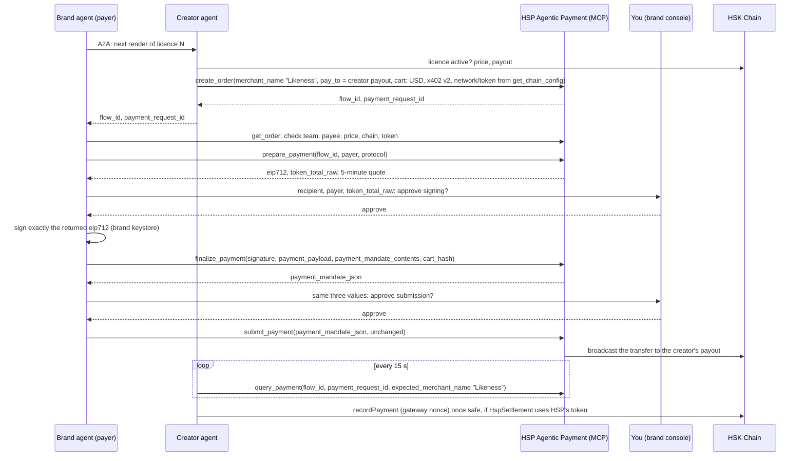

# Real HSP Agentic Payment on QA

HashKey's **HSP Agentic Payment** (guide "Setup and Execution Guide", HSP QA, revision 2026-10-30) is an
MCP server, `https://mcp-qa.hashkeymerchant.com/` (Streamable HTTP, configuration key
`hsp-agentic-payment`), with eight tools: `get_chain_config`, `create_order`, `get_order`,
`prepare_payment`, `finalize_payment`, `estimate_fee`, `submit_payment`, `query_payment`. HSP manages the
App Key and App Secret on its side. Our agents use it through the official MCP client SDK
(`@modelcontextprotocol/sdk` 1.32.1).

**Status (2026-10-30):** built and tested offline against an MCP emulator with the same eight tools.
HashKey's QA server needs our egress IP on its allowlist first; the one health check before that answered
HTTP 403. No payment has been made on QA yet; this page says so until one has.

## The flow



## What the code enforces (from the guide)

- All eight tools must be listed before any call (`finalize_payment` above all); a missing one stops it.
- Every call is checked against the tool's **live** input schema: a required property we don't have, or one
  we'd send that the schema doesn't have, stops the call. Where the guide gives a meaning but not a name
  (the payer of `prepare_payment`), the name is taken from the live schema.
- We never build x402 JSON, hashes or JWTs. The wallet signs exactly the returned `eip712` (domain, types,
  primaryType, message); `payment_mandate_json` goes to `submit_payment` unchanged.
- **Two approvals** in the brand console, each showing the recipient (`pay_to`), the payer and
  `token_total_raw` (raw units, with the token's decimals): before signing and before submitting.
  Cancelling says what did and didn't happen; an unanswered approval is cancelled when its quote expires.
- Before signing: the quote must be for the creator's on-chain payout, this payer, and the token from
  `get_chain_config`; the payer's balance of that exact token contract must cover `token_total_raw`; the
  amount must fit the brand's per-render cap.
- Quotes last 5 minutes: on expiry or error 30043, prepare again and sign the new quote. The old
  signature is never submitted. An uncertain submission is checked with `query_payment`, never resent.
- `query_payment` every 15 s with the same identifiers and `expected_merchant_name` "Likeness";
  `payment-safe` is reported as "on-chain, half the required confirmations, not yet finalized";
  `payment-finalized` as final; `payment-timeout` keeps polling; 10 minutes without an end state is
  reported as "Pending confirmation" and polling continues.
- The live server isn't contacted until the allowlisting is confirmed (`HSP_ALLOWLISTED=1`).
- **Manual by the team, never by the agent:** funding the payer wallet with the test token, and any
  Permit2 approval. `pnpm hsp:agentic commands` prints the exact commands; it runs none of them.

## Run it

```sh
cd agents
pnpm hsp:agentic health                         # the one check allowed before allowlisting (done: 403)
HSP_ALLOWLISTED=1 pnpm hsp:agentic tools        # list the eight tools; save their live schemas
HSP_ALLOWLISTED=1 pnpm hsp:agentic diff         # live schemas against the emulator's: same, adapted, stop
HSP_ALLOWLISTED=1 pnpm hsp:agentic chain-config # networks and tokens HSP offers
HSP_PAYER=0x… pnpm hsp:agentic commands         # the manual funding / approval commands for the team
LIKENESS_HSP=agentic HSP_ALLOWLISTED=1 pnpm app # brand console against HashKey's QA server
LIKENESS_HSP=agentic LIKENESS_MODE=local pnpm app   # offline: the MCP emulator on a local chain
LIKENESS_HSP=agentic pnpm run testnet           # command line; both approvals by typing "yes"
```

**Live schemas.** Every call is checked against the tool's live input schema. A name that differs only in
an unambiguous, clearly equivalent way (camelCase for snake_case, or `payer_address` for `payer`) is mapped
and noted; objects and JSON strings are converted to the type the schema asks for; answers in camelCase
are read under the guide's names. Anything else stops before the call: a missing name, a name with two
candidates, a required field the flow doesn't know, or another type. The full checklist for the live run is
[HSP_LIVE_RUN.md](HSP_LIVE_RUN.md).

## HspSettlement: the Gateway's nonce

HSP builds the `eip712`, so the Gateway chooses the authorization nonce. HspSettlement already supports
this (`nonceBound = false`): the creator's agent reads the executed nonce from the transaction
(EIP-3009's `AuthorizationUsed`, or the Permit2 call), or uses the nonce the brand's agent signed, and
the contract checks on chain that the licensee's authorization with that nonce executed and is counted
once. No contract change is needed.

**Redeploy plan (not done until you say so).** The contracts are deployed for our TestUSDT; HSP pays in
the token `get_chain_config` names. To record HSP payments on chain, HspSettlement, LicenseRegistry and
ReceiptAnchor are redeployed with that token (and its rail and Permit2 address); CreatorRegistry stays.
Estimate from the gas these deployments used (5.87M) at today's testnet gas price (1.001 gwei):
**about 0.0059 testnet HSK**, plus about 0.001 for the Safe ownership handover and the creator naming its
agent again. Prepared: `pnpm run deploy -- --network testnet --hsp-token` (a dry run with the estimate;
`--broadcast` deploys, after keeping the old deployment file). Until then the app pays through HSP and says plainly that the payment isn't recorded on
chain.

## Honest notes

- **QA, testnet:** HSP's QA environment and testnet tokens; no real money.
- **Offline emulator:** the same eight tools with the field names from the guide, against a local chain.
  HashKey's live schemas are the authority; the client checks them on every call.
- **Payer wallet:** the brand's own keystore signs (the guide's example uses OKX Agentic Wallet; any
  EIP-712 signer works).
- **Not yet run on QA:** no QA order, signature, transaction or attribution exists yet.
